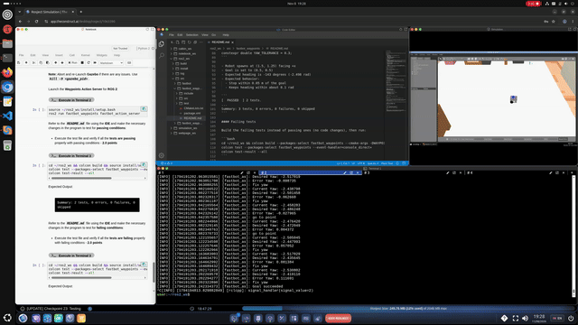

# fastbot_waypoints


## Task 2, ROS2 Tests

ROS2 (Galactic) C++ waypoints action server for the FastBot (port of Task 1), plus GTest node level tests

### Repo Files,

#### Code Files
- `../fastbot_waypoints_msgs/action/WaypointAction.action`:
  - Goal: `position`
  - Result: `success`
  - Feedback: `position` and `state`
- `src/fastbot_action_server.cpp`: action server `fastbot_as`
  1. Turns robot to face the goal
  2. Then drives toward goal
  3. Stops at goal

#### Test Files
- `CMakeLists.txt` option `WAYPOINTS_FAIL_TEST` (default `OFF`) picks which of the two test files is 
- `test/main.cpp`: GTest main
- `test/waypoints_test_fixture.hpp`: shared test fixture, goal is set at the top of the file
- `test/waypoints_passing_test.cpp`: passing tests (normal tolerances)
- `test/waypoints_failing_test.cpp`: failing tests (tolerances tighter than the action server can reach)

  Before each test (`SetUp`):
  1. Resets the Gazebo world
  2. Sends goal to `fastbot_as` and waits for the result
  3. Records the end pose

  Tests check:
  - `EndPositionTest`: end position **[X, Y]** is within `XY_TOLERANCE` of goal
  - `EndYawTest`: end rotation **[Yaw]** is within `YAW_TOLERANCE` of expected yaw (from start position)

### Running Simulation and Action Server

Terminal 1, start simulation:

```bash
source ~/ros2_ws/install/setup.bash
ros2 launch fastbot_gazebo one_fastbot_room.launch.py
```

Terminal 2, action server:

```bash
cd ~/ros2_ws && colcon build && source install/setup.bash
ros2 run fastbot_waypoints fastbot_action_server
```

Terminal 3, check action server:

```bash
source ~/ros2_ws/install/setup.bash
ros2 action send_goal --feedback /fastbot_as fastbot_waypoints_msgs/action/WaypointAction "{position: {x: 0.5, y: 0.5}}"
```

Expected behavior:
1. Robot turns to face the goal
2. Drives toward goal
3. Terminal 2 logs `fix yaw` / `go to point`
4. Terminal 3 shows feedback, 
    - Then `Result: success: true` and `Goal finished with status: SUCCEEDED`

Manual robot reset:
- Place robot back at start, `ros2 service call /reset_world std_srvs/srv/Empty`

### Running tests,

#### Passing Tests
Terminal 3, run tests:

```bash
cd ~/ros2_ws && colcon build && source install/setup.bash
colcon test --packages-select fastbot_waypoints --event-handler=console_direct+
colcon test-result --all
```

Each test resets Gazebo world, so robot always starts from the spawn pose

Goals in `test/waypoints_test_fixture.hpp` and Tolerances in `test/waypoints_passing_test.cpp`:

```cpp
constexpr double GOAL_X = 0.5;
constexpr double GOAL_Y = 0.5;
constexpr double XY_TOLERANCE = 0.1;
constexpr double YAW_TOLERANCE = 0.3;
```

- Robot spawns at (1.5, 1.25) facing +x
- Goal is set to (0.5, 0.5)
- Expected heading is -143 degrees (-2.498 rad)
- Expected behavior:
  - Stop within 0.05 m of the goal
  - Keeps heading within about 0.1 rad

```
[  PASSED  ] 2 tests.
...
Summary: 3 tests, 0 errors, 0 failures, 0 skipped
```

#### Failing tests

Build the failing tests instead of passing ones (no code changes), then run:

```bash
cd ~/ros2_ws && colcon build --packages-select fastbot_waypoints --cmake-args -DWAYPOINTS_FAIL_TEST=ON && source install/setup.bash
colcon test --packages-select fastbot_waypoints --event-handler=console_direct+
colcon test-result --all
```

`test/waypoints_failing_test.cpp` sets the error margins tighter than action server can reach (0.05m and  2 degrees):

```cpp
constexpr double XY_TOLERANCE = 0.001;
constexpr double YAW_TOLERANCE = 0.001;
```

Both tests fail:

```
[  FAILED  ] WaypointsTestFixture.EndPositionTest
[  FAILED  ] WaypointsTestFixture.EndYawTest
...
Summary: 3 tests, 0 errors, 3 failures, 0 skipped
```

Option to build failing tests is saved in the CMake cache, so later plain `colcon build` keeps building failing tests. Switch back to the passing tests with:

```bash
cd ~/ros2_ws && colcon build --packages-select fastbot_waypoints --cmake-args -DWAYPOINTS_FAIL_TEST=OFF && source install/setup.bash
```

## Task 2, Result



## Notes

Changes from the given `tortoisebot_action_server.py` when porting to ROS2 C++:
- FastBot drives along the -y axis of `fastbot_base_link` (its camera faces -y), so server and the tests use odom yaw minus 90 degrees as the robot heading
- Forward speed is set to 0.2 m/s instead of 0.6 m/s, as in Task 1
