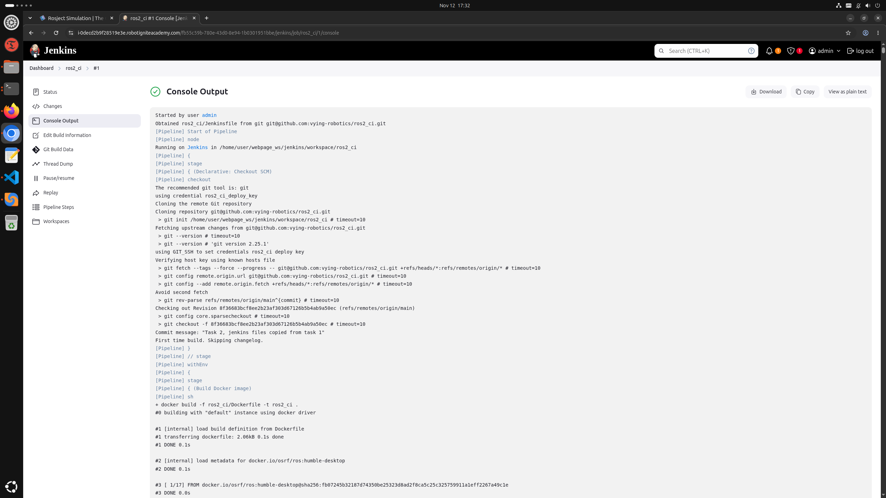

# ros2_ci

Jenkins CI for the Checkpoint 23 `fastbot_waypoints` tests (ROS 2 Humble, FastBot simulation in Gazebo)

## Packages
- `fastbot/` - FastBot simulation packages
- `fastbot_waypoints/` - waypoints action server and tests (GTest) from Checkpoint 23
- `fastbot_waypoints_msgs/` - waypoints action definition from Checkpoint 23
- `ros2_ci/` - Checkpoint 24 files (this folder):
  - `Dockerfile` - ROS 2 Humble + Gazebo image with FastBot simulation and waypoints packages built
  - `install_docker.sh` - installs and starts Docker in the rosject (same as `ros1_ci/install_docker.sh`)
  - `run_waypoints_test.sh` - runs in the container: 
    1. Starts the simulation
    2. Runs tests
    3. Shuts Gazebo down
  - `install_jenkins_plugins.sh` - downloads the Jenkins plugins (Pipeline + Git), versions for Jenkins 2.479.3 (same as `ros1_ci`)
  - `start_jenkins.sh` - starts Docker and Jenkins (Jenkins home `~/webpage_ws/jenkins`, same Jenkins as `ros1_ci`)
  - `setup_deploy_key.sh` - creates the GitHub SSH key Jenkins uses to read this repository, adds github.com to known hosts
  - `Jenkinsfile` - Jenkins pipeline: 
    1. Builds Docker image
    2. Runs tests in container

## Docker setup

The rosject does not come with Docker. Installation and execution needed, if not done yet with `ros1_ci` or missing after a rosject restart

```bash
bash ~/ros2_ws/src/ros2_ci/install_docker.sh
```

Notes:
- `install_docker.sh` is same script as `~/simulation_ws/src/ros1_ci/install_docker.sh`, running either one is enough
- If Docker is already installed but stopped (`docker ps` fails):
  - `sudo service docker start && sudo chmod 666 /var/run/docker.sock` (Docker recreates socket on every start)

## Building and Running containerized tests manually

Build Docker image:

```bash
cd ~/ros2_ws/src
docker build -f ros2_ci/Dockerfile -t ros2_ci .
```

Terminal 1, start container and FastBot simulation:

```bash
xhost +local:root
docker run --rm -it --name ros2_ci_container -e DISPLAY=$DISPLAY -v /tmp/.X11-unix:/tmp/.X11-unix ros2_ci
ros2 launch fastbot_gazebo one_fastbot_room.launch.py
```

Terminal 2, start waypoints action server:

```bash
docker exec -it ros2_ci_container bash
source /ros2_ws/install/setup.bash
ros2 run fastbot_waypoints fastbot_action_server
```

Terminal 3, run waypoints tests:

```bash
docker exec -it ros2_ci_container bash
source /ros2_ws/install/setup.bash
cd /ros2_ws
colcon test --packages-select fastbot_waypoints --event-handlers console_direct+
colcon test-result --all
```

Same tests in one command with Gazebo GUI, for Jenkins:

```bash
xhost +local:root
docker run --rm -e DISPLAY=$DISPLAY -v /tmp/.X11-unix:/tmp/.X11-unix ros2_ci /run_waypoints_test.sh
```

## Jenkins setup (run once)

Jenkins 2.479.3 used, appropriate plugin versions pinned for it

Same Jenkins instructions as `ros1_ci`. If Jenkins was already set up with `ros1_ci`, skip to step 4.

1. Download plugins (with Jenkins not running):

```bash
bash ~/ros2_ws/src/ros2_ci/install_jenkins_plugins.sh
```

2. Start Jenkins, print initial admin password and Jenkins URL:

```bash
bash ~/ros2_ws/src/ros2_ci/start_jenkins.sh
cat ~/webpage_ws/jenkins/secrets/initialAdminPassword
cat ~/jenkins__pid__url.txt
```

3. Open Jenkins URL, paste initial admin password:
   - **Select plugins to install** > **None** > **Install** (plugins already downloaded)
   - **Skip and continue as admin** > **Not now** > **Start using Jenkins**
   - Change admin password: **admin** > **Configure** > **Password** > **Save**

4. Set up deploy key (lesson 7.2) so Jenkins can read the repository over SSH:

```bash
bash ~/ros2_ws/src/ros2_ci/setup_deploy_key.sh
```

   - Prints the 3 items below (key and github.com host keys kept in `~/webpage_ws`)
      1. Add public key on GitHub, `ros2_ci` > **Settings** > **Deploy keys** > **Add deploy key**
          - Title `jenkins`
          - **Allow write access**: not needed
          - GitHub allows a deploy key on one repository only, so `ros2_ci` has its own key
      2. Add private key on Jenkins, **Manage Jenkins** > **Credentials** > **(global)** > **Add credentials**
          - Kind: **SSH Username with private key**
            - ID: `ros2_ci_deploy_key`
            - Description: `ros2_ci deploy key`
            - Username: `git`
          - Private Key: **Enter directly** > **Add**, paste key, Passphrase empty > **Create**

5. Create project: **New Item** > `ros2_ci` > **Pipeline** > **OK**
   - Triggers: **Poll SCM**, Schedule `* * * * *` (checks repository every minute)
   - Pipeline: **Pipeline script from SCM**
     - SCM **Git**
        - Repository URL: `git@github.com:vying-robotics/ros2_ci.git`
        - Credentials: `git (ros2_ci deploy key)`
        - Branch Specifier: `*/main`
     - Script Path: `ros2_ci/Jenkinsfile`
   - **Save** and **Build Now** once (first build downloads ROS 2 Humble image, which takes several minutes)

## Start Jenkins

```bash
bash ~/ros2_ws/src/ros2_ci/start_jenkins.sh
cat ~/jenkins__pid__url.txt
```

- `start_jenkins.sh` installs Java, starts Docker (installs Docker if missing after a rosject restart) and copies github.com host keys to `~/.ssh/known_hosts`
- If Jenkins is already running (e.g. started with `ros1_ci`), it prints `Jenkins is running already. Exiting.`

Open Jenkins URL printed by the last command and log in:

- Username: `admin`
- Password: `password`

## Test with a pull request

1. Create pull request on `https://github.com/vying-robotics/ros2_ci` (e.g. add a small `.txt` file)
2. Accept pull request and merge into `main`
3. Jenkins starts a new build of `ros2_ci`
4. Open build under **Build History** > **Console Output** (desired output):
   1. `Build Docker image`: image build
   2. `Run waypoints tests`: 
      1. `Gazebo GUI: true`, Gazebo starts in the rosject **Graphical Tools**
      2. FastBot spawns
      3. Action server starts
      4. Robot drives to goal twice
      5. `[  PASSED  ] 2 tests`
      6. `Summary: 3 tests, 0 errors, 0 failures, 0 skipped`
      7. `Stopping Gazebo...`
      8. `Gazebo shut down`
   3. `Finished: SUCCESS`: Last line

# Task 2 Result

Start of console output for first successful build,

